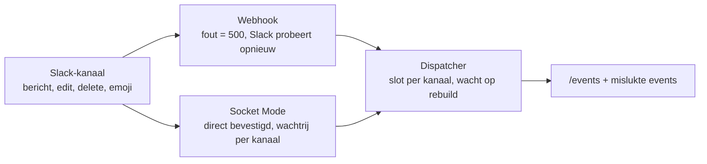

# Slack-sync: hoe het werkt

Bron: [Claude Doc](https://claude.ai/code/artifact/5e7f69bb-3c35-4041-8553-e73751f0bd18); bijgewerkt 2026-10-02.

## Overzicht

Slack is leidend: wat in het groepskanaal staat, is de waarheid. De app leest berichten met bestanden als inzendingen en emoji van juryleden als beoordelingen. Gaat er iets mis, dan herstelt de app dat vanuit Slack, niet andersom.

- Elke groep heeft één Slack-kanaal.
- Een bericht met een of meer bestanden wordt een inzending per bestand.
- Een emoji van een jurylid (ingesteld onder Reviewers) zet de status van die inzendingen.
- Wijzigingen op het dashboard (overrides) zijn tijdelijk: een volledige rebuild gooit ze weg.

## Live events

Slack stuurt elk event direct naar de app, via de webhook of via Socket Mode. Welke van de twee draait, staat in de configuratie.

- **Webhook**: de app verwerkt het event binnen het verzoek. Bij een fout antwoordt de app met 500 en probeert Slack het nog een paar keer.
- **Socket Mode**: de app bevestigt het event meteen en zet het in een wachtrij per kanaal. Bij een fout probeert Slack het niet opnieuw.
- **Volgorde**: events van één kanaal worden één voor één verwerkt. Catch-up en overrides wachten op hun beurt.
- **Dubbel**: een bestand wordt nooit twee keer opgeslagen. De app herkent het aan kanaal, bericht en bestand.

## Beoordelingen en overrides

Een emoji van een jurylid op het bericht bepaalt de status van alle inzendingen in dat bericht. Haalt het jurylid de emoji weg, dan gaat de status terug naar open.

- Alleen Slack-gebruikers in de lijst Reviewers tellen mee.
- Een **override** op het dashboard zet een status zonder emoji. De app noteert die als "Dashboard override".
- Catch-up en het opnieuw draaien van een event laten overrides staan.
- Een volledige rebuild gooit overrides weg; ze staan dan alleen nog in de back-up-JSON.
- Tijdens een rebuild kun je geen override zetten.

## Catch-up

De catch-up leest de kanalen van vandaag (vanaf middernacht) opnieuw en vult aan wat de app gemist heeft. Hij verwijdert niets en laat overrides staan.

- **Wanneer**: bij het starten van de app, en in Socket Mode bij elke herverbinding. Een admin kan hem ook zelf starten met **Catch-up nu draaien** op `/events`.
- **Herstelt**: gemiste inzendingen en emoji die niet bij de status passen.
- **Herstelt niet**: verwijderde berichten. Daarvoor zet je het mislukte event opnieuw in gang, of herbouw je de groep.
- Het resultaat verschijnt als melding in de eventlog op `/events`.
- In handmatige modus draait de catch-up niet.

## Mislukte events

Elk event dat mislukt, wordt bewaard en staat bovenaan `/events` onder **Mislukte events**. Het blijft daar staan, ook na een herstart, tot het lukt of een admin het negeert.

| Knop | Wat het doet |
| --- | --- |
| Opnieuw | Draait dit ene event nog een keer. |
| Alles opnieuw | Draait alle open fouten, oudste eerst: eerst het bericht, dan de beoordeling ervan. |
| Negeren | Haalt de fout uit de lijst, bijvoorbeeld een emoji op een bericht zonder bestand. |
| Catch-up nu draaien | Leest de kanalen van vandaag opnieuw; zie Catch-up. |

- **Bericht, bewerking, verwijdering**: de app draait het event precies zoals Slack het stuurde. Bestanden die al binnen zijn, worden niet dubbel opgeslagen.
- **Emoji**: de app draait het oude event niet na. Hij leest de emoji die nu in Slack op het bericht staan. Zo telt wat het jurylid inmiddels besloten heeft.
- Lukt het nog steeds niet, dan telt de kolom **Pogingen** op en staat de nieuwe fout erbij.
- Stuurt Slack hetzelfde event zelf nog eens en lukt het dan, dan verdwijnt de fout vanzelf.
- Tijdens een rebuild kun je geen event opnieuw draaien.

## Herstelladder

Begin bij de lichtste stap en ga pas verder als die niet helpt. Alleen de laatste twee stappen gooien gegevens weg.

1. **Event opnieuw** op `/events`. Voor één gemist bericht of één beoordeling. Overrides blijven staan.
2. **Catch-up nu draaien** op `/events`. Voor alles wat vandaag gemist is, ook berichten die niet als fout in de lijst staan (bijvoorbeeld tijdens een herstart). Overrides blijven staan; verwijderde berichten herstelt hij niet.
3. **Groep herbouwen** op de pagina van de groep. Leest het kanaal van één groep helemaal opnieuw in. Overrides van die groep gaan verloren.
4. **Volledige rebuild** onder Configuratie. Alleen als laatste redmiddel: alle overrides en handmatige beoordelingen gaan verloren. Ze staan nog in `submissions.json` in de back-upmap.

## Wie mag wat

Juryleden zien alles; alleen admins kunnen iets herstellen. Admin word je door op Beheer de beheerderssleutel in te vullen.

| Actie | Jury | Admin |
| --- | --- | --- |
| `/events` en mislukte events bekijken | ja | ja |
| Event opnieuw, alles opnieuw, negeren | nee | ja |
| Catch-up nu draaien | nee | ja |
| Override op een inzending | nee | ja |
| Groep herbouwen, volledige rebuild | nee | ja |

Wordt de beheerderssleutel opnieuw gemaakt, dan zijn open tabbladen geen admin meer. De knoppen weigeren dan op de server.

## Checklist voor zaterdag

- [ ] Verbindingsstatus bovenin de app is groen.
- [ ] Jury-Slack-ID's staan allemaal onder Reviewers.
- [ ] Elke groep staat in de configuratie met het juiste kanaal.
- [ ] Minstens één coordinator per dienst heeft de beheerderssleutel.
- [ ] Tijdens het spel: `/events` open houden en de lijst Mislukte events in de gaten houden.
- [ ] Na een storing of herstart: eerst Catch-up nu draaien, dan Alles opnieuw.
- [ ] Geen volledige rebuild zonder overleg: overrides gaan verloren.
